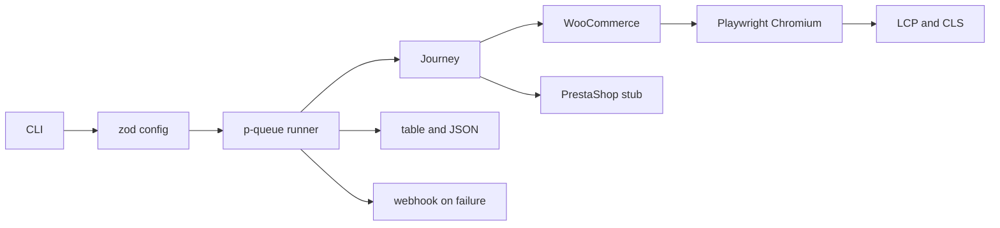

# checkout-check

A Node.js worker that walks an e-commerce checkout and reports pass or fail, with timings.

Stores break in small ways: a selector rename, a stuck cart, a checkout template that never paints. This runs that path on a schedule you control (cron, CI, or by hand) and leaves a table, a JSON report, and a screenshot when something dies. It stops on the checkout page. It does not place an order.

## Quick start

```bash
pnpm install
pnpm exec playwright install chromium
pnpm demo
```

`pnpm demo` serves the local fixture shop and runs the WooCommerce journey against it. No account and no live store.

The CLI itself:

```bash
pnpm checkout-check run --config examples/checks.json
pnpm checkout-check run --config examples/checks.yaml --json artifacts/report.json
```

Exit code is `1` when a check fails or the failure webhook errors. That is enough for CI.

## Config

JSON or YAML, checked with zod before a browser opens. `webhookUrl` is optional and off unless you set it. A failing run POSTs JSON to that URL; a green run stays quiet.

```json
{
  "concurrency": 2,
  "screenshotDir": "artifacts/screenshots",
  "checks": [
    {
      "name": "fixture-shop",
      "platform": "woocommerce",
      "baseUrl": "http://127.0.0.1:4173",
      "productPath": "/product.html",
      "cartPath": "/cart.html",
      "timeoutMs": 10000,
      "selectors": {
        "addToCart": "button.single_add_to_cart_button",
        "checkoutLink": "a.checkout-button",
        "checkoutReady": "h1.checkout-title"
      }
    }
  ]
}
```

Each check needs `cartPath` or `selectors.cartLink`. Point `baseUrl` at a store you are allowed to hit. The example targets the fixture, not a real shop.

WooCommerce steps: home, product, add to cart, cart, checkout page visible. Core Web Vitals (LCP and CLS) are read on home and checkout via `PerformanceObserver`.

## Output

```text
name          platform     status  duration  failed step
------------  -----------  ------  --------  -----------
fixture-shop  woocommerce  pass    840ms     -
broken-cart   woocommerce  fail    9001ms    cart

2 checks, 1 failed
```

`--json artifacts/report.json` writes the same run: per-step timings, vitals, final URL, and the screenshot path when a step failed.

Webhook body (failure only):

```json
{
  "source": "checkout-check",
  "failed": [
    { "name": "broken-cart", "platform": "woocommerce", "error": "missing", "steps": [] }
  ]
}
```

## Architecture



`Journey` is the extension point. `getJourney()` maps `platform` to an object with `run(page, check)`. WooCommerce is the one implementation. PrestaShop is registered and throws a clear "not implemented" error so the next journey is a new file, not a new runner.

## Design decisions

- One Chromium, one browser context per check. Concurrency is a queue limit, not N browser processes.
- Selectors and URLs live in config. The journey code does not hard-code a theme.
- Failure handling is boring on purpose: catch the step, skip the rest, screenshot, non-zero exit.
- The fixture shop is static HTML served on `127.0.0.1`. CI never needs a merchant account.
- Webhook stays off by default so a local run cannot notify a URL you did not name.

## Scripts

| Script | What it does |
| --- | --- |
| `pnpm lint` | ESLint |
| `pnpm typecheck` | `tsc --noEmit` |
| `pnpm test` | Vitest, then the Playwright fixture test |
| `pnpm demo` | Fixture shop plus one WooCommerce run |
| `pnpm build` | Emit `dist/` for the `checkout-check` bin |

Node 20 or newer. pnpm. TypeScript strict, ESM.

## Roadmap

- A real PrestaShop journey next to the stub in `src/journeys/prestashop.ts`.
- Scheduling outside the process (cron or a worker queue) so this file stays a single run.
- A small dashboard over the JSON reports. The worker should keep printing a table; storage can come later.

## License

MIT. Copyright (c) 2026 Arnaud Merigeau. See `LICENSE`.
